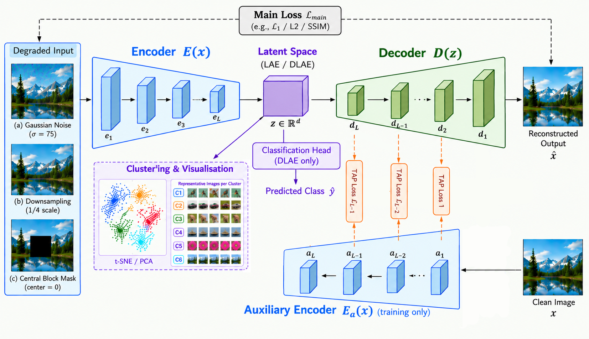

# Hierarchical Feature Alignment with a Dual-Encoder Framework for Unified Image Restoration, Classification, Visualization, and Clustering

This repository provides the training and evaluation code for a family of autoencoder-based models designed to address multiple image-processing tasks within a unified framework.

The implementation includes:

* Image denoising
* Image super-resolution
* Image inpainting / missing-data recovery
* Image classification
* Image clustering
* Latent-space representation learning
* Transfer/alignment of semantic information through the latent representation

---

## 📌 Overview

The proposed framework investigates autoencoder architectures for learning useful image representations while simultaneously supporting different downstream tasks.

The repository contains implementations of three main models:

* **DFA** — baseline dual-feature autoencoder
* **LAE** — latent autoencoder
* **DLAE** — dual latent autoencoder with an additional prediction/classification component



The framework employs a Transfer Alignment Prediction (TAP) loss to align hierarchical features from the auxiliary encoder and decoder, encouraging the transfer of fine-grained information across corresponding feature levels.

The models can be trained with different datasets and image degradation types.

### Supported degradation types

| Degradation      | Description                                       |
| ---------------- | ------------------------------------------------- |
| Gaussian noise   | Additive Gaussian noise                           |
| Super-resolution | Downsampling followed by reconstruction           |
| Missing data     | Removal of image information followed by recovery |

### Supported datasets

The current implementation includes loaders for:

* MNIST
* CIFAR-10
* SVHN
* CelebA
* ImageNet
* MedMNIST
* DFB-HR

The DFB-HR dataset is additionally supported through a patch-based data-loading pipeline for high-resolution image restoration experiments.

---

## 🏗️ Repository Structure

```text
.
├── README.md
├── requirements.txt
│
├── main.py
├── model.py
├── data.py
├── degradation.py
├── get_data_loaders.py
├── get_patched_data_loaders.py
├── training.py
├── training_utilities.py
├── checkpoint_utils.py
│
├── configs/
│   ├── training/
│   ├── evaluation/
│   └── losses/
│
└── notbock/
    └── experiments.ipynb
```

### Main files

| File                          | Description                                               |
| ----------------------------- | --------------------------------------------------------- |
| `main.py`                     | Main entry point and experiment configuration             |
| `model.py`                    | Definitions of DFA, LAE, DLAE, and model components       |
| `data.py`                     | Dataset loading and dataset-specific preprocessing        |
| `degradation.py`              | Image degradation functions                               |
| `get_data_loaders.py`         | Construction of standard training/validation/test loaders |
| `get_patched_data_loaders.py` | Patch-based data loading for DFB-HR                       |
| `training.py`                 | Reconstruction and classification training procedures     |
| `training_utilities.py`       | Loss functions and training utilities                     |
| `checkpoint_utils.py`         | Checkpoint loading, and training continuation             |
| `evaluate.py`                 | Evaluation procedures and performance metrics             |
| `notebooks/training.ipynb`    | Lightweight notebook interface for running experiments    |

---

# 🚀 Installation

## 1. Clone the repository

```bash
git clone https://github.com/ilyesfennour/Hierarchical-Feature-Alignment-with-a-Dual-Encoder-Framework.git
cd Hierarchical-Feature-Alignment-with-a-Dual-Encoder-Framework
```

## 2. Create a virtual environment

We recommend using a dedicated Python environment.

### Windows

```bash
python -m venv venv
venv\Scripts\activate
```

### Linux/macOS

```bash
python3 -m venv venv
source venv/bin/activate
```

## 3. Install dependencies

```bash
pip install -r requirements.txt
```

For GPU training, install the appropriate PyTorch version for your CUDA configuration if necessary.

---

# 📂 Dataset Preparation

The repository does **not** include the datasets.

### Automatic Download

No manual download is required for the following datasets, which are downloaded automatically by their respective loaders:

- **MNIST**
- **MedMNIST**
- **CIFAR-10**
- **SVHN**

### Manual Download — Training Datasets

Download the following datasets from Kaggle:

- **CelebA:** [Kaggle Dataset](https://www.kaggle.com/datasets/jessicali9530/celeba-dataset)
- **DFB-HR:** Combine the following three sources into a single `DFB-HR/` folder:
  - DIV2K: [Kaggle Dataset](https://www.kaggle.com/datasets/soumikrakshit/div2k-high-resolution-images)
  - Flickr2K: [Kaggle Dataset](https://www.kaggle.com/datasets/daehoyang/flickr2k)
  - BSD500: [Kaggle Dataset](https://www.kaggle.com/datasets/balraj98/berkeley-segmentation-dataset-500-bsds500)
- **ImageNet:** Merge the following four sources into `train/`:
  - [ImageNet Part 0](https://www.kaggle.com/datasets/sautkin/imagenet1k0)
  - [ImageNet Part 1](https://www.kaggle.com/datasets/sautkin/imagenet1k1)
  - [ImageNet Part 2](https://www.kaggle.com/datasets/sautkin/imagenet1k2)
  - [ImageNet Part 3](https://www.kaggle.com/datasets/sautkin/imagenet1k3)

  Download the [ImageNet validation dataset](https://www.kaggle.com/datasets/sautkin/imagenet1kvalid) and place it in `test/`, as a sibling of `train/`.

### Manual Download — Evaluation Benchmarks

The following datasets are used for evaluating image restoration, denoising, and super-resolution performance:

**Image Inpainting / Completion**
- **CelebA:** [Kaggle Dataset](https://www.kaggle.com/datasets/jessicali9530/celeba-dataset)
- **SVHN:** [Kaggle Dataset](https://www.kaggle.com/datasets/xiake666/svhm-dataset)
- **Paris StreetView:** [Kaggle Dataset](https://www.kaggle.com/datasets/arrowjrssgss/parisstreet)
- **Places2:** [Kaggle Dataset](https://www.kaggle.com/datasets/nguynhoitrung/places2-256-flatten)

**Image Denoising**
- **CBSD68:** [Kaggle Dataset](https://www.kaggle.com/datasets/tarekmebrouk/cbsd68)
- **Kodak24:** [Kaggle Dataset](https://www.kaggle.com/datasets/mustafaalkhafaji95/kodak-dataset)
- **McMaster:** [Kaggle Dataset](https://www.kaggle.com/datasets/liikke/mcmaster)
- **Set12:** [Kaggle Dataset](https://www.kaggle.com/datasets/abdulfatahnasrat/set12-test)
- **Urban100:** [Kaggle Dataset](https://www.kaggle.com/datasets/sahilchawla7/urban100)
- **BSD68:** [Kaggle Dataset](https://www.kaggle.com/datasets/zaminahmad/bsd68-dataset)

**Image Super-Resolution**
- **Set5:** [Kaggle Dataset](https://www.kaggle.com/datasets/chenqizhou/set5-hr-lr)
- **Set14:** [Kaggle Dataset](https://www.kaggle.com/datasets/sahilnsut/set14dataset)
- **BSD100:** [Kaggle Dataset](https://www.kaggle.com/datasets/huaiyingu/bsd100)
- **Urban100:** [Kaggle Dataset](https://www.kaggle.com/datasets/sahilchawla7/urban100)
- **DIV2K:** [Kaggle Dataset](https://www.kaggle.com/datasets/soumikrakshit/div2k-high-resolution-images)

### Expected Directory Structure

```text
data/
├── CelebA/
├── DFB-HR/
│   ├── DIV2K/
│   ├── Flickr2K/
│   └── BSD500/
├── ImageNet/
│   ├── train/
│   └── test/
└── benchmarks/
    ├── ParisStreetView/
    ├── Places2/
    ├── CBSD68/
    ├── Kodak24/
    ├── McMaster/
    ├── Set12/
    ├── BSD68/
    ├── Urban100/
    ├── Set5/
    ├── Set14/
    └── BSD100/
```

---

# 🏋️ Training

The training pipeline is implemented in `main.py`. Models can be trained using command-line arguments or JSON configuration files.

### 1. Command-line training

The following example trains a DFA model on MNIST for image denoising:

```bash
python main.py \
    --autoencoder DFA \
    --dataset MNIST \
    --degradation denoising \
    --epochs 50 \
    --batch_size 128 \
    --learning_rate 0.0002 \
    --workers 4 \
    --num_layers 4 \
    --tap_layers 3 \
    --sigma 0.2941
```

For classification and clustering experiments, use `--degradation none`.

**Available training parameters:**

| Parameter | Description |
|---|---|
| `--autoencoder` | Model architecture: `DFA`, `LAE`, or `DLAE`. |
| `--dataset` | Dataset used for training (e.g., MNIST, CIFAR-10, CelebA). |
| `--root_dir` | Root directory containing the datasets. |
| `--degradation` | Input degradation: denoising, super-resolution, missing data, or none. |
| `--max_samples_per_class` | Maximum number of training samples per class. |
| `--epochs` | Number of training epochs. |
| `--batch_size` | Number of samples per training batch. |
| `--learning_rate` | Optimizer learning rate. |
| `--workers` | Number of data-loading worker processes. |
| `--num_layers` | Number of encoder/decoder layers. |
| `--tap_layers` | Number of layers used for the TAP mechanism. |
| `--latent_dim` | Dimensionality of the latent representation. |
| `--sigma` | Noise standard deviation for denoising. |
| `--scale_factor` | Downsampling factor for super-resolution. |
| `--pretrained_path` | Path to pretrained model weights. |
| `--checkpoint_dir` | Directory used to save or restore experiment checkpoints. |
| `--additional_epochs` | Number of additional epochs when continuing training. |
| `--config` | Path to a JSON training configuration file. |
| `--losses_config` | Path to a JSON file specifying loss functions and their weights. |

### 2. JSON training configurations

For convenience and reproducibility, the repository provides example training configurations in `configs/training/`. These cover different model architectures, datasets, and tasks. You can modify an existing configuration or create your own.

If you use a manually downloaded dataset, specify its location by setting `root_dir` in the JSON configuration file or passing `--root_dir` directly as a command-line argument.

To launch an experiment using a configuration file:

```bash
python main.py --config configs/training/mnist_dfa.json
```

### 3. Loss configurations

Four example loss configuration files are provided in `configs/losses/`:

- `dfa_losses.json` — Loss configuration for DFA.
- `lae_losses.json` — Loss configuration for LAE.
- `rc_loss.json` — Loss configuration for the RC variant.
- `mr_loss.json` — Loss configuration for the MR variant.

Specify a loss configuration using `--losses_config`:

```bash
python main.py \
    --config configs/training/mnist_dfa.json \
    --losses_config configs/losses/dfa_losses.json
```

These files can be modified to adjust the loss functions and their weights without changing the training code.

### 4. Overriding configuration parameters

Command-line arguments can override values defined in a JSON configuration file. For example:

```bash
python main.py \
    --config configs/training/mnist_dfa.json \
    --epochs 100 \
    --batch_size 64 \
    --learning_rate 0.0001
```

The configuration priority is:

1. Default parameters.
2. Values specified in the JSON configuration file.
3. Explicitly provided command-line arguments.

The separate `--losses_config` argument can also be used to specify or replace the loss configuration.

---

# 💾 Checkpoints and Training Continuation

The training pipeline supports saving checkpoints, loading pretrained weights, resuming interrupted experiments, and extending training for additional epochs.

The evaluation pipeline loads saved checkpoints and reports the corresponding quantitative metrics.

### Resuming or extending training

Specify the checkpoint directory using `--checkpoint_dir` and control training continuation with `--additional_epochs`:

- Set `--additional_epochs 0` to resume training using the remaining epochs.
- Set a positive value to add that number of epochs to the remaining training schedule.

**Resume training:**
```bash
python main.py \
    --checkpoint_dir checkpoints/experiment_1 \
    --additional_epochs 0
```

**Extend training by 50 epochs:**
```bash
python main.py \
    --checkpoint_dir checkpoints/experiment_1 \
    --additional_epochs 50
```

### Loading pretrained weights

To initialize training from pretrained weights, specify the checkpoint path using `--pretrained_path`:

```bash
python main.py \
    --autoencoder DFA \
    --dataset MNIST \
    --pretrained_path checkpoints/pretrained_model.pth
```

The checkpoint directory and experiment configuration must be valid to restore the corresponding training state.

---

# 📊 Evaluation

The evaluation pipeline is implemented in `evaluate.py`. It supports evaluating trained models on restoration, classification, and clustering tasks using command-line arguments or JSON configuration files.

### 1. Command-line evaluation

Example: Evaluating a DFA model on MNIST for image denoising:

```bash
python evaluate.py \
    --checkpoint checkpoints/mnist_dfa/best_model.pth \
    --mode restoration \
    --dataset MNIST \
    --degradation denoising \
    --sigma 0.2941 \
    --batch_size 128 \
    --workers 4
```

**Available evaluation parameters:**

| Parameter        | Description                                                            |
| ---------------- | ---------------------------------------------------------------------- |
| `--checkpoint`   | Path to the trained model checkpoint.                                  |
| `--mode`         | Evaluation task: `restoration`, `classification`, or `clustering`.     |
| `--dataset`      | Dataset used for evaluation.                                           |
| `--root_dir`     | Root directory containing the evaluation dataset.                      |
| `--degradation`  | Input degradation: denoising, super-resolution, missing data, or none. |
| `--sigma`        | Noise standard deviation for denoising.                                |
| `--scale_factor` | Downsampling factor for super-resolution.                              |
| `--batch_size`   | Number of samples per evaluation batch.                                |
| `--workers`      | Number of data-loading worker processes.                               |
| `--config`       | Path to a JSON evaluation configuration file.                          |

For classification and clustering, use the corresponding `--mode` and set `--degradation none`.

### 2. JSON evaluation configurations

Example evaluation configurations are provided in `configs/evaluation/`. You can modify them to specify the checkpoint, dataset, evaluation mode, and other parameters.

If you use a manually downloaded dataset, specify its location by setting `root_dir` in the JSON configuration file or passing `--root_dir` directly as a command-line argument.

Run an evaluation using a configuration file:

```bash
python evaluate.py --config configs/evaluation/mnist_restoration.json
```

---

# 📓 Notebook

The repository also includes `notbock/experiments.ipynb`, providing a notebook-based interface for training and evaluating models. It allows you to configure experiments, run training, and evaluate saved checkpoints interactively.

You can run the notebook locally or using Google Colab. Make sure to install the required dependencies and configure the dataset paths before running the experiments.

---

# 🖼️ Qualitative Results

The following figures illustrate representative restoration results
obtained using the proposed models across different image-processing tasks.


# 📈 Quantitative Results

The following results summarize the performance of the proposed models
on image restoration, classification, and clustering benchmarks.


---

# 📝 Citation

If you use this code or the proposed models in your research, please cite the associated paper:

The citation information will be updated once the paper is published.

---

# 📜 License

This project is released under the license specified in:

---

# 🙏 Acknowledgements

We acknowledge the open-source datasets, libraries, and research projects that made this work possible.

In particular, this project makes use of the Python scientific-computing and deep-learning ecosystem, including PyTorch, torchvision, scikit-learn, and related libraries.

---

# 📬 Contact

For questions regarding the implementation or the research, please open an issue in this repository or contact the authors through their institutional/research profiles.
